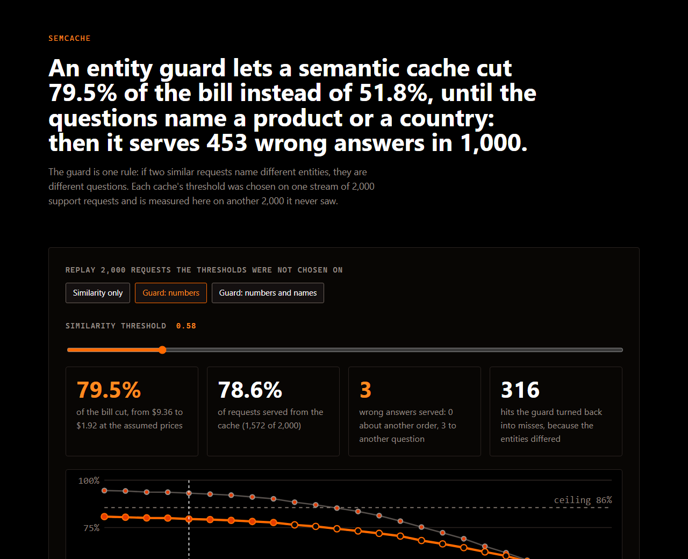

# semcache

### An entity guard lets a semantic cache cut 79.5% of the bill instead of 51.8%, until the questions name a product or a country: then it serves 453 wrong answers in 1,000.

A semantic cache answers a request from a stored answer when a new request is similar enough to an old one, so the model is not asked again. The danger is the near miss: "where is order 1042" is as similar to "where is order 1043" as two sentences get. The guard is one rule: if two requests name different entities they are different questions, however alike they are. This measures what that rule buys, and where it stops working.

Drag the threshold, switch the guard, and the page shows the bill, the hit rate and every wrong answer word for word.



## What it measured

Each cache's threshold is chosen on one stream of 2,000 support requests, the one that cuts the most with no wrong answer, and then measured on a second stream of 2,000 it was never chosen on. Choosing and reporting on the same stream flatters any number it picks, and the first version of this project did exactly that.

| measured on the second stream | similarity only | guard: numbers | guard: numbers and names |
|---|---|---|---|
| threshold, chosen on the first stream | 0.92 | 0.58 | 0.58 |
| the bill | cuts 51.8% | cuts 79.5% | cuts 79.4% |
| wrong answers | 0 | 3 | 3 |
| at the usual threshold of 0.80 | 160 wrong answers | 0 wrong answers | 0 wrong answers |

The guard is worth the difference between 51.8% and 79.5% of the bill, because it lets the threshold drop from 0.92 to 0.58 without serving another order's answer. The 3 wrong answers it does serve on the second stream are a different question about the same order: "where is my refund for order 1160" was answered with the stored reply to "where is my order 1160", at a similarity of 0.680. The first stream had none, which is why choosing on it said zero.

The most any cache could cut on the second stream is 85.5%, if every repeat were answered from cache and none wrongly.

## Where the guard stops working

The guard compares what it knows to be an entity, and the first version knew digits only. A third stream of 1,000 requests asks about a product or a country instead of an order: "is the blue kettle in stock", "how long does delivery to cyprus take". At the same thresholds:

| 1,000 questions about a product or a country | wrong answers |
|---|---|
| similarity only, at 0.92 | 0 |
| guard: numbers, at 0.58 | **453** |
| guard: numbers and names, at 0.58 | 15 |

With digits only, "how much is the pine desk" is answered with the stored price of the oak desk. Given the shop's own 14 names, its products and the countries it ships to, the guard turns those back into misses, and 15 wrong answers remain: a different question about the same product, and names the customer misspelled. A guard cannot compare an entity it was never told about, so its threshold is only as safe as its list.

## How a hit is decided

1. The request is embedded and compared with every stored request.
2. The best match at or above the threshold is a hit and its stored answer is served.
3. With a guard, a match that names different entities is not a hit. It counts as a miss, the model is asked, and the new answer is stored.

`src/lib/cache.ts` decides, `src/lib/entities.ts` says what an entity is, and the page runs the same files the measurement ran.

## What this does not show

**The requests are templated.** 24 questions asked in 3 to 6 ways each, with greetings, typos and capitals added, in Zipf shaped frequencies. Real traffic has more ways to ask, so the ceiling is higher here than a real log would give. Take the shape of the curves, not the percentages.

**The embedder is not a neural model.** It is hashed character and word n-grams, so the repository has no dependencies and the page runs it in a tab. A neural embedder separates paraphrases better and would move every number. Swapping it changes `src/lib/embed.ts` and nothing else.

**Zero on a stream is not zero.** The calibration stream showed no wrong answer at 0.58 and the second stream showed 3. Similarity alone showed none on either at 0.92, which bounds its rate below about 0.15% with 95 percent confidence on streams like these, and no further.

**The prices are assumptions.** $3 in and $15 out per million tokens, with the token counts of each answer in `tools/intents.ts`. A wrong answer is counted as a saving; a customer who has to ask again costs more than that.

**One author.** The questions, the streams and the cache were written by one person. The streams are committed with their hashes in `data/streams.sha256`.

## Run it

```sh
npm ci
npm run measure     # chooses on data/calibrate.json, measures on data/test.json and data/words.json
npm run check       # the replay must match the committed file, and the README must match both
npm run build       # typecheck, check, then the page
npx playwright install chromium
npm run verify      # the built page in a browser at 1280 and 390, against the measurement
npm run capture     # the picture above and the link preview card
```

## What is in here

| path | what |
|---|---|
| `src/lib/cache.ts` | the cache and the guard, about forty lines |
| `src/lib/entities.ts` | what counts as an entity: digits, or digits and a list of names |
| `src/lib/embed.ts` | the hashed n-gram embedder |
| `tools/intents.ts` | the questions, their phrasings, their token counts, and the shop's names |
| `tools/streams.ts` | the three streams, from fixed seeds |
| `tools/measure.ts` | choose, measure, break |
| `tools/check-*.ts` | the gates |

Synthetic data throughout. MIT licence.
